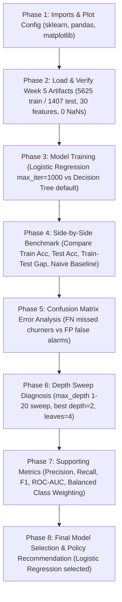
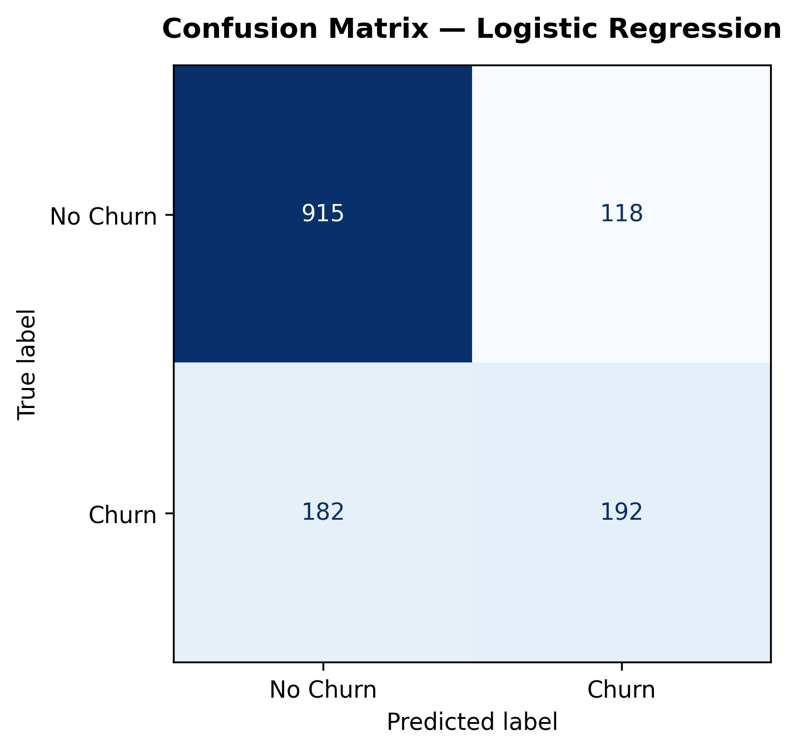
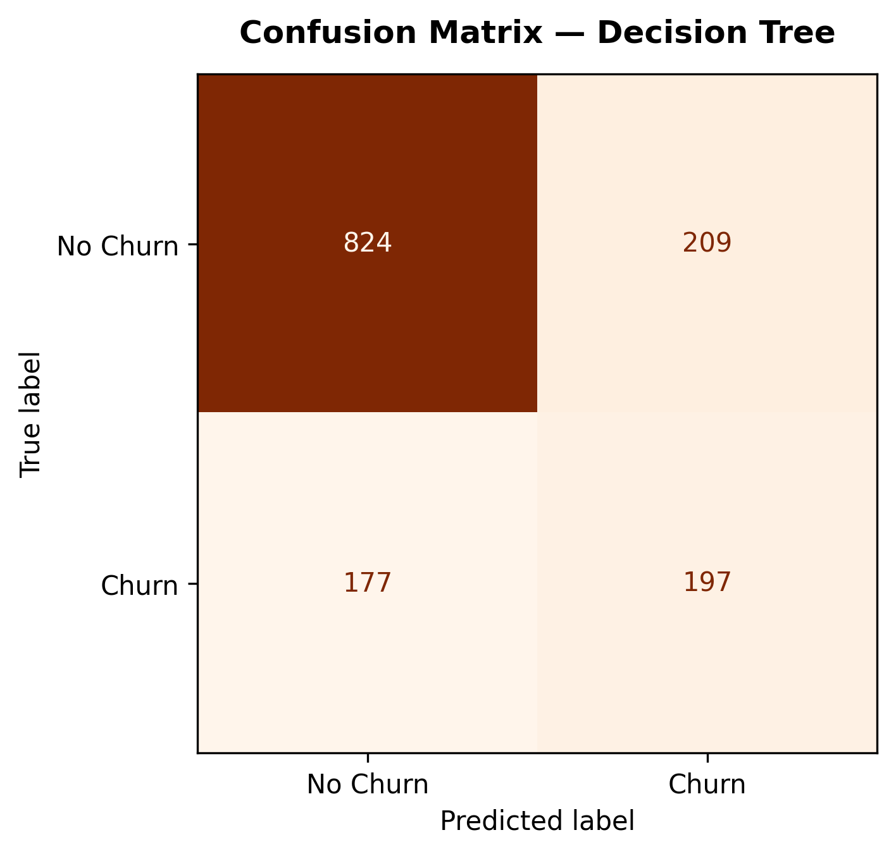
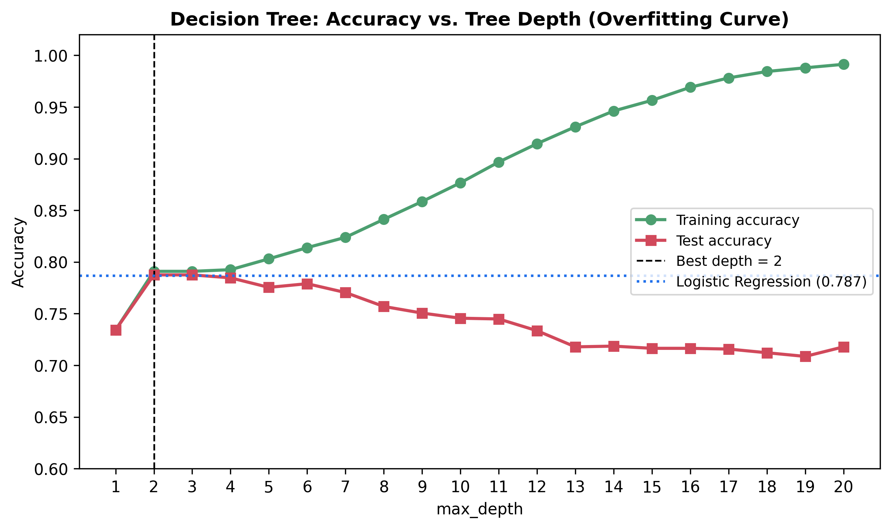

# Customer Purchase / Churn Predictor — Telco Churn Model Benchmark & Overfitting Diagnosis

An end-to-end model benchmarking and error diagnosis study (`Week6_Telco_Churn_Model_Benchmark.ipynb`) comparing parametric linear classification (**Logistic Regression**) against non-parametric tree-based modeling (**Decision Tree Classifier**) on the preprocessed **IBM Telco Customer Churn** dataset (30 features, 80/20 leak-free split from Week 5).


---

## Executive Summary

| Model Variant | Train Acc | Test Acc | Train–Test Gap | Churn Recall | Churn Precision | ROC-AUC | Status / Verdict |
| :--- | :---: | :---: | :---: | :---: | :---: | :---: | :--- |
| **Naive Baseline (Always No Churn)** | — | **73.42%** | — | 0.0% | 0.0% | 0.5000 | Zero-signal baseline |
| **Logistic Regression (Default)** | **80.91%** | **78.68%** | **0.0223** | **51.34%** | **61.94%** | **0.6996** | **Recommended for Production** |
| **Decision Tree (Default, Unpruned)** | **99.77%** | **72.57%** | **0.2720** | 52.67% | 48.52% | 0.6622 | **Severe Overfitting** (loses to naive baseline) |
| **Decision Tree (Tuned, `max_depth=2`)** | 80.05% | **78.75%** | 0.0130 | 39.57% | 66.97% | 0.6625 | Overfitting resolved (leaves cut from 1,119 to 4) |
| **Logistic Regression (Balanced)** | 74.88% | **73.13%** | 0.0175 | **79.14%** | 49.33% | 0.7491 | **High-Recall Retention Variant** |

### Key Findings
1. **Logistic Regression Wins on Generalization:** With a train-test accuracy gap of just **0.0223** (80.91% train vs. 78.68% test), Logistic Regression avoids overfitting and provides a **+5.26 percentage point lift** over the naive majority-class baseline.
2. **Default Decision Tree Overfits Severely:** The unconstrained tree memorized the training sample (depth 29, 1,119 leaves across 5,625 rows; ~5 samples/leaf), hitting **99.77% train accuracy** but collapsing to **72.57% test accuracy** — **performing worse than predicting "No Churn" for every customer (73.42%)**.
3. **Hyperparameter Tuning Fixes the Tree:** Restricting `max_depth=2` through an empirical depth sweep recovers test accuracy to **78.75%** (+6.18 percentage points over default) and collapses complexity to just 4 leaves.
4. **Class-Balanced Alternative:** When business priorities mandate capturing the maximum number of at-risk customers, setting `class_weight="balanced"` on Logistic Regression boosts churn recall from **51.34% to 79.14%**.

---

## Table of Contents

- [Dataset & Verification Contract](#dataset--verification-contract)
- [Workflow Architecture (8 Phases)](#workflow-architecture-8-phases)
- [Side-by-Side Model Benchmark](#side-by-side-model-benchmark)
- [Confusion Matrix & Error Profiling](#confusion-matrix--error-profiling)
- [Overfitting Diagnosis & Depth Sweep](#overfitting-diagnosis--depth-sweep)
- [Comprehensive Metrics & Supporting Analysis](#comprehensive-metrics--supporting-analysis)
- [Business Impact & Actionable Insights](#business-impact--actionable-insights)
- [Generated Visual Artifacts](#generated-visual-artifacts)
- [How to Run](#how-to-run)
- [Repository Structure](#repository-structure)

---

## Dataset & Verification Contract

The experiment ingests model-ready CSV splits generated by the Week 5 Automated ML Preprocessor:

- **Source Split URL:** `https://raw.githubusercontent.com/NarenMSD/getintern-week5-telco-churn-ml-preprocessor/main/`
- **Features ($X$):** 30 standardized predictors (one-hot encoded categoricals with `drop_first=True`; continuous features `tenure`, `MonthlyCharges`, `TotalCharges` scaled via `StandardScaler` fitted strictly on train data).
- **Target ($y$):** Binary customer churn (`0` = No Churn, `1` = Churn).
- **Splits:**
  - `X_train.csv` / `y_train.csv`: **5,625 rows × 30 columns** (Churn rate: 26.58%)
  - `X_test.csv` / `y_test.csv`: **1,407 rows × 30 columns** (Churn rate: 26.58%; 1,033 No Churn, 374 Churn)
- **Sanity Verification Gate (Phase 2):**
  - Confirmed 30 features across splits.
  - Confirmed 0 `NaN` values in `X_train` and `X_test`.
  - Confirmed exact column name and order parity (`list(X_train.columns) == list(X_test.columns)`).
  - Explicit rule enforced: **Do NOT re-encode or re-scale.**

---

## Workflow Architecture (8 Phases)



| Phase | Notebook Section | Focus & Key Implementation |
| :--- | :--- | :--- |
| **Phase 1** | Imports & Setup | Configures Matplotlib DPI (110) and imports scikit-learn models & metrics. |
| **Phase 2** | 1. Load Preprocessed Data | Loads the 4 Week 5 CSV splits; validates schema integrity via 4 assertions. |
| **Phase 3** | 2. Model Training | Fits Logistic Regression (`max_iter=1000`, converged in 40 iters) and Decision Tree (`random_state=42`). |
| **Phase 4** | 3. Accuracy Benchmark | Calculates train/test accuracies and generalisation gaps; benchmarks against 73.42% baseline. |
| **Phase 5** | 4. Confusion Matrix Analysis | Plots and saves high-resolution confusion matrix figures; evaluates FN and FP trade-offs. |
| **Phase 6** | 5. Decision Tree Depth Sweep | Sweeps `max_depth` (1–20) to plot the empirical overfitting curve; trains tuned `max_depth=2` tree. |
| **Phase 7** | 6. Supporting Metrics | Evaluates Precision, Recall, F1, ROC-AUC; trains balanced Logistic Regression. |
| **Phase 8** | 7. Model Selection Summary | Synthesizes technical and business trade-offs into an actionable deployment strategy. |

---

## Side-by-Side Model Benchmark

Both models were evaluated on the identical 1,407-sample held-out test set:

| Metric | Logistic Regression | Decision Tree (Default) | Performance Gap |
| :--- | :---: | :---: | :---: |
| **Training Accuracy** | 80.91% | 99.77% | -18.86 pp |
| **Test Accuracy** | **78.68%** | **72.57%** | **+6.11 pp (LR leads)** |
| **Train–Test Generalization Gap** | **0.0223** | **0.2720** | **12.2× smaller gap in LR** |
| **Lift over 73.42% Naive Baseline** | **+0.0526 (+5.26 pp)** | **-0.0085 (-0.85 pp)** | Tree falls below baseline |
| **Tree Complexity** | N/A (Linear coefficients) | Depth: 29 \| Leaves: 1,119 | Unconstrained growth |
| **Iterations to Convergence** | 40 (`max_iter=1000`) | N/A | Fast convergence |

### Why Logistic Regression Outperformed the Decision Tree
1. **Smooth Linear & Monotonic Boundary:** The primary churn drivers (tenure length, contract duration, payment channel) exert steady, monotonic influence on churn probability. A linear hyper-plane models this geometry cleanly, whereas an orthogonal tree must construct an inefficient staircase of axis-aligned cuts.
2. **Sample-to-Parameter Ratio:** Fitting 1,119 leaves on 5,625 training rows averages fewer than 5 customers per terminal leaf. The tree memorized random statistical variations rather than underlying customer retention behavior.

---

## Confusion Matrix & Error Profiling

In telecom churn management, prediction errors have asymmetric commercial costs:
- **False Negative (FN) — Missed Churner (Expensive):** A customer destined to leave is predicted to stay. No proactive retention incentive is offered, leading to total customer loss and high replacement acquisition costs.
- **False Positive (FP) — False Alarm (Manageable):** An existing loyal customer is flagged as churning. A retention discount or courtesy outreach is triggered, resulting in modest margin reduction but preserving the customer.

| Confusion Matrix — Logistic Regression | Confusion Matrix — Decision Tree |
| :---: | :---: |
|  |  |

| Confusion Matrix Metric | Logistic Regression | Decision Tree (Default) | Analysis |
| :--- | :---: | :---: | :--- |
| **True Negatives (TN)** | **915** | 824 | LR correctly identifies 91 more retained accounts |
| **False Positives (FP)** | **118** | 209 | Decision tree generates **77% more false alarms** |
| **False Negatives (FN)** | 182 | **177** | Default tree catches 5 more churners at extreme FP cost |
| **True Positives (TP)** | 192 | 197 | Comparable raw catch rate |
| **Churn Class Recall** | 51.34% (192 / 374) | 52.67% (197 / 374) | Decision tree: +1.33 pp recall |
| **Churn Class Precision** | **61.94%** (192 / 310) | **48.52%** (197 / 406) | **LR: +13.42 pp precision** |

---

## Overfitting Diagnosis & Depth Sweep

To empirically demonstrate that the tree's poor test accuracy was caused by unconstrained depth, Phase 6 performed a parametric sweep across `max_depth` from 1 to 20:

- **Training Accuracy:** Climbed strictly monotonically from ~78% at depth 1 to ~99% at depth 20.
- **Test Accuracy:** Peaked early at **`max_depth = 2`**, plateaued through depth 5, and progressively degraded back toward 72% as depth reached 20.



```text
Decision Tree Complexity & Accuracy Progression:
- Default Tree (Unconstrained): Depth = 29 | Leaves = 1,119 | Test Acc = 72.57% | Gap = 0.2720
- Tuned Tree (max_depth = 2)  : Depth =  2 | Leaves =     4 | Test Acc = 78.75% | Gap = 0.0130
```

Constraining `max_depth=2` lifted test accuracy by **+6.18 percentage points** (+0.0618) and reduced the leaf count from 1,119 to just **4 leaves**, producing a simple, highly auditable decision stump that outperforms the default tree.

---

## Comprehensive Metrics & Supporting Analysis

Because the dataset has class imbalance (~26.6% churn), evaluating multi-class classification metrics provides a complete picture:

### Summary Comparison Table

| Model | Accuracy | Precision (Churn) | Recall (Churn) | F1-Score | ROC-AUC |
| :--- | :---: | :---: | :---: | :---: | :---: |
| **Logistic Regression (Default)** | 0.7868 | 0.6194 | 0.5134 | **0.5614** | **0.6996** |
| **Decision Tree (Default)** | 0.7257 | 0.4852 | 0.5267 | 0.5051 | 0.6622 |
| **Decision Tree (max_depth=2)** | **0.7875** | **0.6697** | 0.3957 | 0.4975 | 0.6625 |
| **Logistic Regression (Balanced)** | 0.7313 | 0.4933 | **0.7914** | 0.6077 | **0.7491** |

### Per-Class Classification Reports

#### 1. Logistic Regression (Default)
```text
              precision    recall  f1-score   support
    No Churn       0.83      0.89      0.86      1033
       Churn       0.62      0.51      0.56       374

    accuracy                           0.79      1407
   macro avg       0.73      0.70      0.71      1407
weighted avg       0.78      0.79      0.78      1407
```

#### 2. Decision Tree (Default, Depth 29)
```text
              precision    recall  f1-score   support
    No Churn       0.82      0.80      0.81      1033
       Churn       0.49      0.53      0.51       374

    accuracy                           0.73      1407
   macro avg       0.65      0.66      0.66      1407
weighted avg       0.73      0.73      0.73      1407
```

#### 3. Decision Tree (Tuned, `max_depth=2`)
```text
              precision    recall  f1-score   support
    No Churn       0.81      0.93      0.87      1033
       Churn       0.67      0.40      0.50       374

    accuracy                           0.79      1407
   macro avg       0.74      0.66      0.68      1407
weighted avg       0.77      0.79      0.77      1407
```

---

## Business Impact & Actionable Insights

### Deployment Recommendation: Logistic Regression
- **Production Choice:** Deploy the **Logistic Regression** baseline. It delivers the highest F1-score (0.5614), strong ROC-AUC (0.6996), reliable generalization (0.0223 gap), and clear interpretability.
- **Why Reject the Default Tree:** Deploying an unpruned decision tree that yields 72.57% test accuracy on a 73.42% non-churn dataset provides negative commercial utility.
- **Operational Levers from Learned Weights:**
  - **Retention Drivers (Negative Churn Weights):** Long customer `tenure` and `Contract_Two year` strongly suppress churn propensity. Incentivizing 1-year and 2-year contract renewals is the most effective retention safeguard.
  - **Churn Risk Indicators (Positive Churn Weights):** Customers using `PaymentMethod_Electronic check` and subscribed to `InternetService_Fiber optic` exhibit heightened churn risk. Interventions should focus on billing usability and service onboarding for fiber subscribers.

### Retention Campaign Variant (`class_weight="balanced"`)
For customer retention campaigns where the commercial cost of a lost customer far outweighs the cost of a retention discount, deploy the **class-weighted Logistic Regression**:
- Churn recall surges from **51.34% to 79.14%** (catching 296 out of 374 churners).
- Overall accuracy remains robust at **73.13%**, matching the naive baseline while surfacing actionable, high-probability churn leads.

---

## Generated Visual Artifacts

The notebook exports publication-quality diagnostic charts at 300 DPI into the `images/` directory:

| Asset Path | Description | Key Insight |
| :--- | :--- | :--- |
| `images/confusion_matrix_logistic_regression.png` | Normalized blue heat-map of Logistic Regression test predictions. | Highlights smooth, balanced error distribution (118 FP vs 182 FN). |
| `images/confusion_matrix_decision_tree.png` | Orange heat-map of Default Decision Tree test predictions. | Shows heavy false positive rate (209 FP) caused by leaf overfitting. |
| `images/decision_tree_depth_sweep.png` | Dual line chart plotting train vs. test accuracy across `max_depth` 1 to 20. | Visualizes the divergence where test accuracy peaks at depth 2 while train reaches 100%. |

---

## How to Run

### Option 1: Google Colab (Recommended)
1. Open [Google Colab](https://colab.research.google.com/).
2. Upload `Week6_Telco_Churn_Model_Benchmark.ipynb`.
3. Run **Runtime → Run all**.
4. The notebook downloads the Week 5 data splits directly from GitHub, executes all models, generates console tables, and exports the 3 PNG charts.

### Option 2: Local Python / Jupyter Environment
```bash
# Clone the repository
git clone https://github.com/NarenMSD/customer-purchase-churn-predictor.git
cd customer-purchase-churn-predictor

# Install dependencies
pip install pandas numpy scikit-learn matplotlib jupyter

# Launch the notebook
jupyter notebook Week6_Telco_Churn_Model_Benchmark.ipynb
```

---

## Repository Structure

```text
.
├── Week6_Telco_Churn_Model_Benchmark.ipynb      # Main benchmarking & diagnosis notebook
├── README.md                                    # Project documentation & benchmark analysis
└── images/                                      # Diagnostic charts & visualization assets
    ├── confusion_matrix_logistic_regression.png # Saved confusion matrix for Logistic Regression (300 DPI)
    ├── confusion_matrix_decision_tree.png       # Saved confusion matrix for Decision Tree (300 DPI)
    └── decision_tree_depth_sweep.png            # Accuracy vs. Tree Depth overfitting curve (300 DPI)
```
